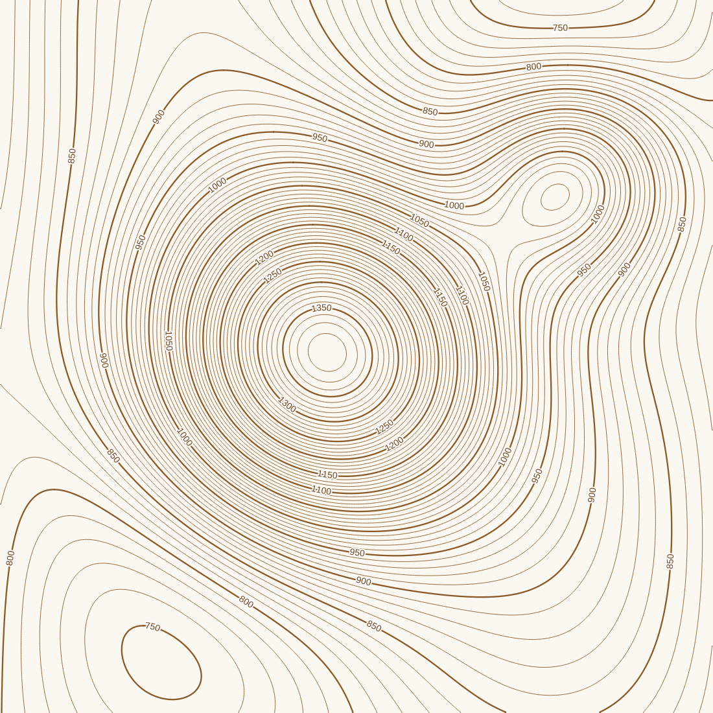
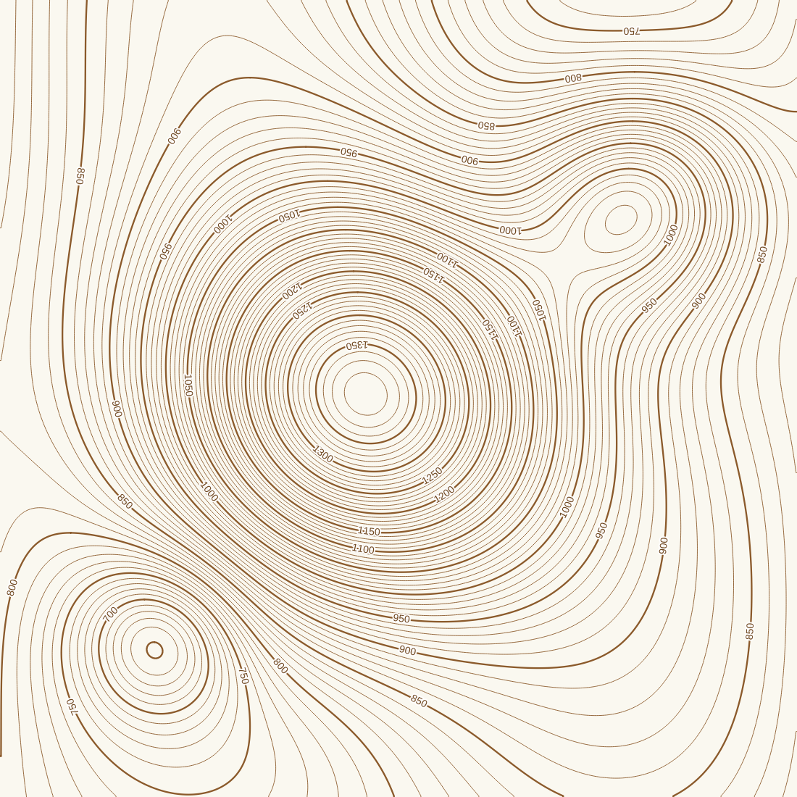

# Contour Label

Plugin QGIS untuk mengisi atribut **indeks (mayor/minor)** dan **label** garis kontur secara otomatis, lengkap dengan style garis dan label siap pakai. Opsional, label bisa diorientasikan **ke atas lereng** sesuai konvensi peta topografi.

Cocok untuk kontur hasil **DEMNAS** (GDAL Contour), **RBI**, maupun **OSM**.

## Fitur

- **Deteksi field ketinggian otomatis** dari nama maupun alias field (`ELEV`, `ele`, "Nilai garis kontur", dan sejenisnya). Field yang kosong seluruhnya otomatis dilewati.
- **Membaca ketinggian berupa angka atau teks**, misalnya `1220`, `"120 m"`, atau `"12,5"`.
- **Deteksi interval kontur otomatis**, termasuk peringatan bila interval data tidak seragam (misalnya gabungan lembar RBI beda skala) dan nilai yang menyimpang dari grid.
- **Klasifikasi mayor/minor** dari *interval × kelipatan* (default kelipatan 5), atau interval mayor yang diisi manual.
- **Mengisi field langsung di layer**:
  - `indeks`: `1` untuk mayor, `0` untuk minor;
  - `label`: angka ketinggian untuk mayor, `NULL` untuk minor.

  Field dibuat otomatis bila belum ada. Field yang sudah ada tetap dipakai, termasuk bila bertipe angka.
- **Style siap pakai**: garis mayor tebal, minor tipis, dan label melengkung mengikuti garis dengan latar putih.
- **Orientasi label ke atas lereng** (opsional): bagian atas angka label menghadap ke tanah yang lebih tinggi. Arah lereng dibaca dari DEM, atau dari kontur tetangga bila tidak ada DEM.
- **Tersedia sebagai algoritma Processing**, sehingga bisa dijalankan dalam batch dan Model Builder, ditambah tombol toolbar untuk akses cepat.

## Orientasi label ke atas lereng

Pada peta topografi, bagian atas angka kontur menghadap ke arah tanah yang naik. Dengan begitu, satu label saja sudah cukup untuk mengetahui arah naik-turun, misalnya untuk membedakan lembah dan punggungan yang sama-sama berbentuk huruf V.

Akibatnya, sebagian label tampil terbalik. Contohnya angka di sisi utara puncak bukit. Hal ini lazim dan disengaja di peta topografi.

Cara kerjanya:
1. Untuk setiap garis, plugin menilai sisi mana yang lebih tinggi di beberapa titik sepanjang garis, lalu mengambil suara terbanyak.
2. Bila perlu, urutan titik garis dibalik. **Bentuk garis tidak berubah.**
3. Label diatur mengikuti arah garis, tanpa dibalik otomatis oleh QGIS. Pengaturan *Upside-down labels* menjadi *Show all*.

Ada dua sumber arah lereng:

| Sumber | Kapan dipakai | Catatan |
|---|---|---|
| DEM (mis. DEMNAS) | Parameter DEM diisi | Paling akurat dan cepat |
| Kontur tetangga | Parameter DEM dikosongkan | Cocok untuk RBI. Lingkaran kecil di area datar bisa tidak terpastikan dan arahnya dibiarkan. |

## Instalasi

1. Unduh ZIP plugin dari halaman [Releases](https://github.com/meowtret/contour-label/releases). Atau buat sendiri: kompres folder `contour_label/` menjadi `contour_label.zip`.
2. Di QGIS, buka **Plugins → Manage and Install Plugins → Install from ZIP**, lalu pilih file ZIP tersebut.
3. Plugin muncul sebagai tombol toolbar, di menu **Vector → Contour Label**, dan di **Processing Toolbox → Contour Label**.

Versi QGIS minimum: 3.22.

## Cara pakai

1. Pilih layer kontur (garis) sebagai layer aktif.
2. Klik tombol **Contour Label** di toolbar.
3. Periksa parameter, lalu jalankan.

| Parameter | Default | Keterangan |
|---|---|---|
| Layer kontur (garis) | layer aktif | Layer yang diisi atributnya |
| Field ketinggian | otomatis | Kosongkan agar dideteksi otomatis |
| Interval kontur | 0 (otomatis) | Dalam meter |
| Garis mayor setiap … garis | 5 | Mayor = interval × kelipatan |
| Terapkan style | ya | Style garis dan label otomatis |
| Orientasikan label ke atas lereng | tidak | Membalik arah garis bila perlu |
| DEM untuk arah lereng | kosong | Opsional; kosong = pakai kontur tetangga |
| Interval mayor *(lanjutan)* | 0 | Isi manual bila interval data tidak seragam |
| Nama field indeks / label *(lanjutan)* | `indeks` / `label` | Bisa disesuaikan |
| Akhiran label *(lanjutan)* | kosong | Mis. `" m"` (hanya untuk field label bertipe teks) |

### Catatan penting

- **Perubahan langsung disimpan ke file.** Bila ingin memeriksa hasil dulu, aktifkan mode edit sebelum menjalankan plugin. Perubahan baru tersimpan saat Anda menekan *Save Layer Edits*.
- **Opsi orientasi mengubah urutan titik geometri secara permanen**, tetapi bentuk garisnya tidak berubah.
- **Layer read-only** (misalnya sebagian FileGDB) perlu disimpan dulu sebagai GeoPackage atau Shapefile.
- **Nama field untuk Shapefile** maksimal 10 karakter.

## Struktur kode

| Berkas | Isi |
|---|---|
| `core.py` | Logika murni Python: deteksi field, konversi nilai, deteksi interval, klasifikasi, format label |
| `orientasi.py` | Penentu arah lereng (DEM dan kontur tetangga) serta pembalikan arah garis |
| `algorithm.py` | Algoritma Processing |
| `styling.py` | Style garis dan label |
| `kompat.py` | Penyesuaian antar-versi QGIS |
| `plugin.py`, `provider.py` | Tombol toolbar, menu, dan provider Processing |

## Riwayat versi

- **0.2.2** — Penulisan enum Processing yang kompatibel Qt6 (QGIS 4).
- **0.2.1** — Perbaikan temuan pemindai keamanan (Bandit) dan impor QAction yang kompatibel Qt6.
- **0.2.0**
  - Nama plugin menjadi *Contour Label*.
  - Opsi orientasi label ke atas lereng.
  - Kategori legenda "Tanpa nilai ketinggian" hanya muncul bila ada.
- **0.1.0** — Versi pertama:
  - deteksi field dan interval;
  - pengisian indeks dan label;
  - style otomatis.

## Lisensi

Contour Label dirilis di bawah [GNU General Public License versi 2](LICENSE) atau (sesuai pilihan Anda) versi setelahnya, sama dengan QGIS.

## Pengembang

Alfian (Ian) — [alfianbphlxii@gmail.com](mailto:alfianbphlxii@gmail.com)

Saran dan laporan masalah: [Issues](https://github.com/meowtret/contour-label/issues).

---

### English summary

*Contour Label* is a QGIS plugin that automatically classifies contour lines into index (major) and intermediate (minor) contours, fills `indeks` and `label` attributes, and applies a ready-to-use line and label style. It auto-detects the elevation field (by name or alias) and the contour interval. Optionally, it orients labels uphill, using either a DEM or neighbouring contours. It works as a Processing algorithm (batch and Model Builder) and from a toolbar button.
